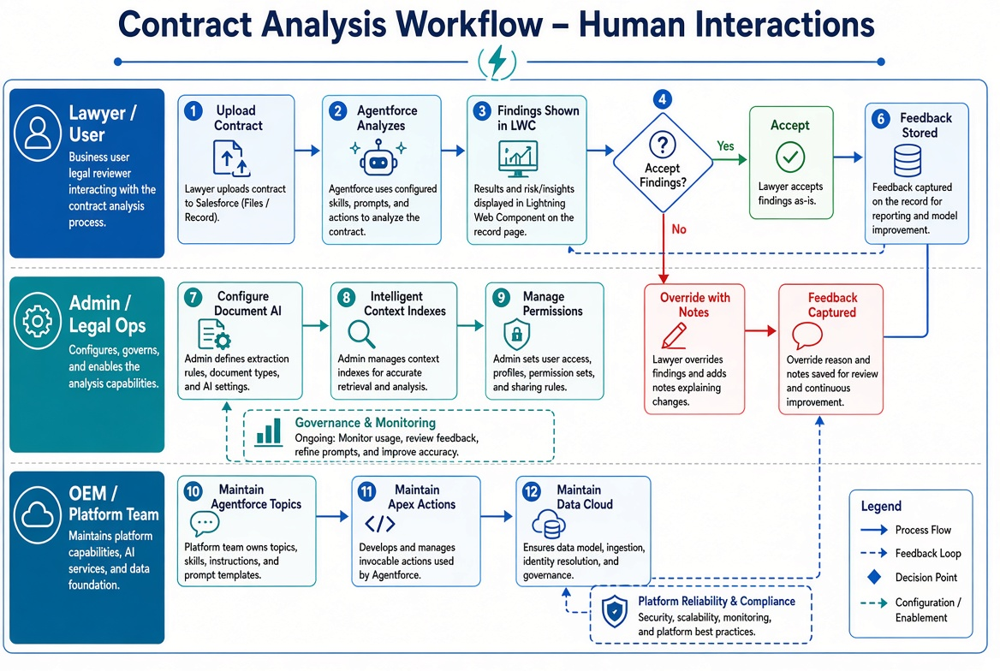
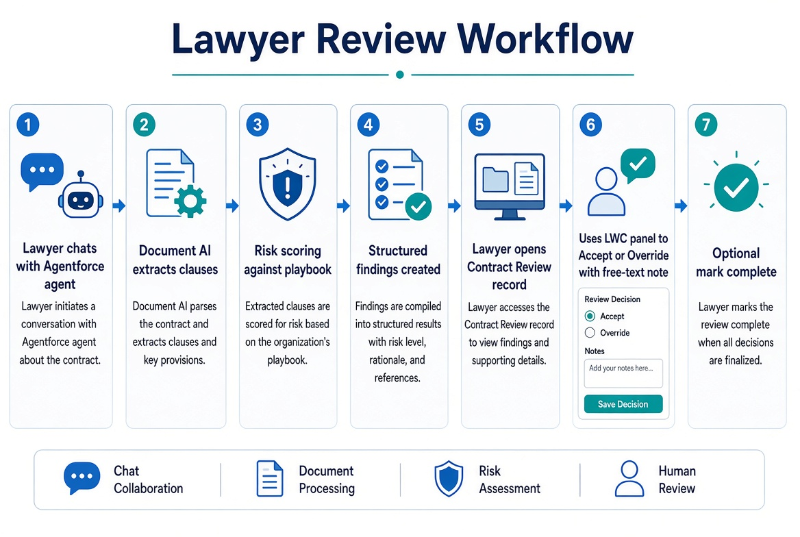

# System Architecture and Workflow Diagrams

These diagrams illustrate the Contract Analysis system architecture and human interactions for lawyers (users), admins/legal ops, and platform/OEM teams.

## System Architecture

**Layers:**
1. Document Ingestion (Document AI / Contracts AI)
2. Hybrid Indexing (Intelligent Context + Knowledge Harmonization with separate namespaces)
3. Retrieval Layer (Data Cloud RAG)
4. Analysis Engine (Agentforce Topics, Apex, Prompt Templates)
5. Output & Human Review (LWC Findings Panel with Accept/Override)

Feedback loop and audit logging are shown.

## Human Interactions Workflow

**Swim lanes:**
- **Lawyer / User**: Upload contract, review findings in LWC, Accept or Override with notes.
- **Admin / Legal Ops**: Configure Document AI, Intelligent Context indexes, and permissions.
- **OEM / Platform Team**: Maintain Agentforce topics, Apex actions, and Data Cloud.

## Lawyer Review Workflow

End-to-end steps from chatting with the Agentforce agent through Document AI extraction, risk scoring, structured findings, LWC Accept/Override with free-text note, and optional completion.

---

The image files (`system-architecture.jpg`, `human-interactions-workflow.jpg`, `lawyer-review-workflow.jpg`) are included in the repository under the `docs/` folder.

These diagrams complement the textual architecture overview in the main README.
